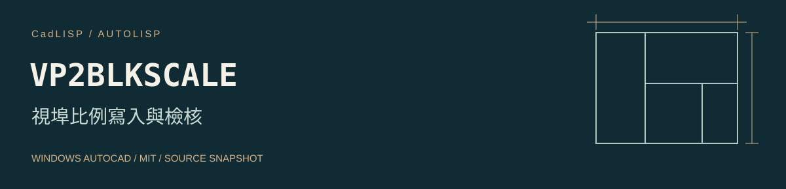

# VP2BLKSCALE 視埠比例寫入與檢核



[工具儲存庫](https://github.com/whos-dwg/CadLISP-VP2BlkScale) · [全部工具索引](https://github.com/whos-dwg/CadLISP-Index)

將視埠 CustomScale 轉為比例文字，寫入圖塊 SCALE 屬性，或檢查附近視埠是否與比例文字一致。

| 項目 | 內容 |
| --- | --- |
| 指令 | `VP2BLKSCALE` |
| 檔案 | [VP2BlkScale.lsp](lsp/VP2BlkScale.lsp) |
| 分類 | 屬性與編號 |
| 狀態 | 來源快照，實機回歸待完成 |
| 授權 | [MIT](LICENSE)，Copyright (c) 2026 whos-dwg |

[安裝](#安裝) · [操作](#操作) · [相依與設定](#相依與設定) · [已知問題](docs/KNOWN_ISSUES.md) · [驗證紀錄](docs/VALIDATION.md)

## 安裝

以 Windows 桌面版 AutoCAD 為目標。原碼使用的 Visual LISP／ActiveX、DCL 或原生命令，需在目標 AutoCAD 版本分別確認；尚未做整包年份、LT、Mac 或其他 CAD 的相容性認證。ActiveX 的平台限制見 [Autodesk](https://help.autodesk.com/cloudhelp/2026/ENU/AutoCAD-AutoLISP/files/GUID-A0459510-CE7A-4206-9EAA-E25AAB569B20.htm)。

1. 下載並解壓縮本工具到固定位置，先開啟測試圖面。
2. 依公司環境把 `lsp` 資料夾加入需要的支援搜尋路徑與受信任位置。
3. 輸入 `APPLOAD`，載入 `VP2BlkScale.lsp`；關閉視窗後輸入 `VP2BLKSCALE`。

也可使用完整路徑單獨載入；下列路徑需依實際位置修改：

```lisp
(load "C:/CAD/CadLISP-VP2BlkScale/lsp/VP2BlkScale.lsp")
```

完成驗證後，可將這支 LISP 加入 APPLOAD 的 Startup Suite。請維持既定的 SECURELOAD 政策，使用受信任位置處理載入限制。[SECURELOAD 說明](https://help.autodesk.com/cloudhelp/2026/ENU/AutoCAD-Core/files/GUID-541566C6-2738-49DD-87C3-C1490E924A02.htm)。

## 操作

1. 輸入 `VP2BLKSCALE`，按 Enter 進入 Write，選一個配置視埠與一個屬性圖塊。
2. 輸入 Check 進行檢核；遇不一致項目時選 Yes 更新，或 No 保留選取。
3. 以 Distance 調整搜尋距離後，再重新執行 Check。

## 相依與設定

圖塊需有可寫入的 `SCALE` 屬性；Check 搜尋距離預設 30 圖面單位。

圖面影響：修改 SCALE 屬性；Check 可批次覆寫不一致項目。

## 行為與限制

Check 使用圖塊附近搜尋範圍內第一個有效視埠，不保證幾何最近；重疊視埠要人工核對。比值以整數文字格式輸出，非常規比例可能因四捨五入而失真。

## 來源與授權

本工具依維護者確認為自行從零撰寫，或以 AI 協作從零開發。程式與本次文件採 [MIT 授權](LICENSE)，允許使用、修改與再散布，須保留授權及著作權聲明。詳細來源紀錄見 [provenance.json](metadata/provenance.json)。

## 回報與維護

回報時附 AutoCAD 完整版本、命令列錯誤與去識別的重現範例。修改前請閱讀 [CONTRIBUTING](CONTRIBUTING.md)；發行步驟見 [PUBLISHING](docs/PUBLISHING.md)。本工具可獨立維護、下載及發布，不依賴其他 CadLISP 工具儲存庫。
